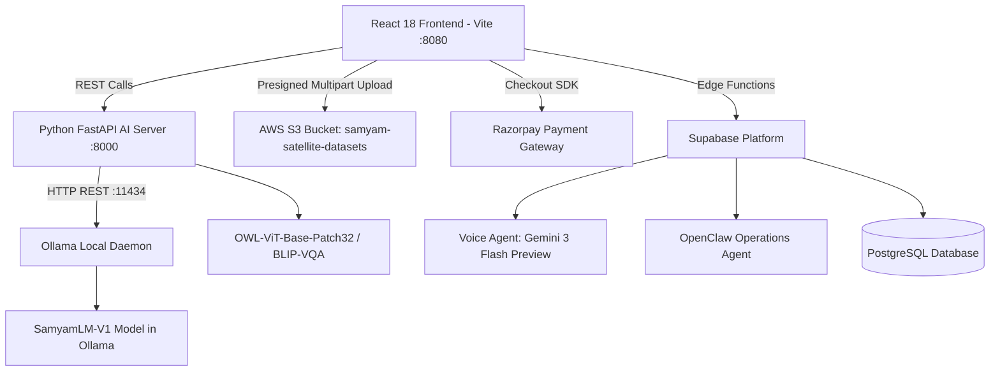

# Architecture — Samyam Space Labels & SamyamLM

> **Technical Architecture & Component Flow**  
> *Repository: Samyam-space-labels | Version: 2.1.0*

---

## 1. System Topology

Samyam Space Labels operates on a split architecture: an air-gapped local AI inference backend running alongside a React/Vite web application with optional Supabase cloud extensions.

---

## 2. Core Subsystems

### A. Local AI Engine (`python/samyam_lm_multimodal/`)
* **Inference Server (`serve_samyam_lm.py`):**
  * Framework: FastAPI + Uvicorn on `http://localhost:8000`.
  * Middleware: CORS configured for `http://localhost:8080`, `http://localhost:5173`, `http://localhost:3000`, `https://samyam.space`, and `*.vercel.app`.
* **Real API Endpoints in Codebase:**
  * `GET /health` — Verifies Ollama connection status, GPU detection (RTX 4050 6GB VRAM), and model availability.
  * `POST /api/v1/decision/system1` — **System 1 Decision Engine (Laya / Jev Paradigm):** Ultra-fast (<35ms) non-autoregressive decision & calibrated probability distribution across choices without token generation latency.
  * `POST /api/v1/decision/two-tier-filter` — Two-Tier Pipeline (Laya System 1 fast filter + SamyamLM deep VLM reasoning), saving 90% GPU compute.
  * `POST /api/v1/analyze` — Receives Base64 image + prompt and executes live multimodal inference.
  * `POST /api/v1/chat` — Multi-turn conversational endpoint using Ollama `/api/chat`.
  * `POST /api/v1/government/mission-intel` — Decodes satellite/drone image bytes, performs target detection, and produces dual-language (English + Devanagari Hindi) tactical briefings.
  * `POST /api/v1/spatial-detect` — GPU bounding box coordinate generator `[ymin, xmin, ymax, xmax]`.
  * `POST /api/v1/prelabel/grounding-dino` — Auto-annotation pipeline for dataset generation.
  * `POST /api/v1/video-drone/analyze-frame` — Live tactical drone video frame analysis with altitude, heading, and telemetry overlays.
  * `POST /api/v1/export/edge-compiler` — Export bundle compiler for NVIDIA Jetson Orin & embedded hardware.

### B. Frontend Architecture (`src/`)
* **Core Application Entry:** `src/App.tsx` with `react-router-dom` v6.
* **Component Breakdown:**
  * **Sovereign Mission AI Console (`src/components/SovereignMissionConsole.tsx`):** Satellite Optical and Tactical Drone UAV modes, coordinate HUD, real-time bounding box visualization, and encrypted JSON dossier export.
  * **Annotation Studio (`src/pages/AnnotationTool.tsx`):** 100KB+ full-featured canvas supporting 2D vision, SAR radar data, polygon segmentation, bounding boxes, and pre-labeling.
  * **Government & Defense Hub (`src/pages/GovernmentHub.tsx`, `GovernmentPage.tsx`):** Showcases specialized programs (`indian-defence-mod`, `isro-space`, `border-maritime`, `indiaai-mission`) with official sovereign agency badges.
  * **Cloud S3 Ingestion (`src/components/AwsS3Uploader.tsx`):** Multipart file upload pipeline to `samyam-satellite-datasets` AWS S3 bucket.
  * **Payment & Payout System (`src/pages/IncomePayments.tsx`, `src/hooks/useRazorpayCheckout.ts`):** Razorpay gateway integration for dataset licensing and annotator rewards.
  * **Client API Bridge (`src/lib/samyamApi.ts`):** Connects frontend to `http://localhost:8000` with an automatic sovereign air-gap fallback generator so the UI never crashes if the local Python server is offline.

### C. Cloud Services (`supabase/functions/`)
* **Voice Agent (`supabase/functions/voice-agent/`):** Audio conversation agent powered by `google/gemini-3-flash-preview`.
* **OpenClaw Operations Agent (`supabase/functions/openclaw-agent/`):** Connects through OpenClaw Gateway token and model.
